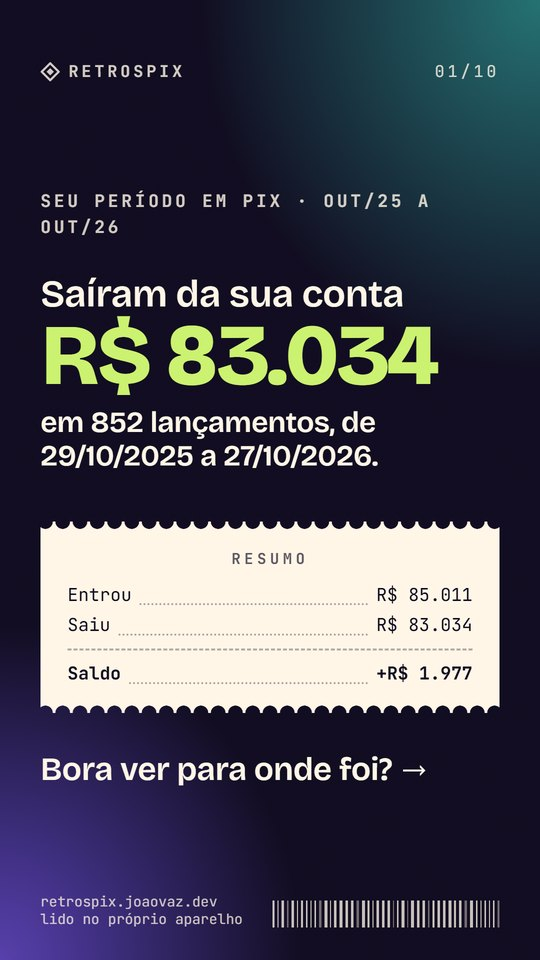
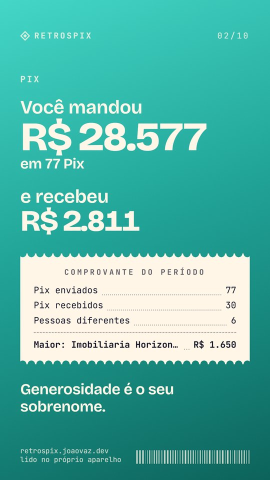
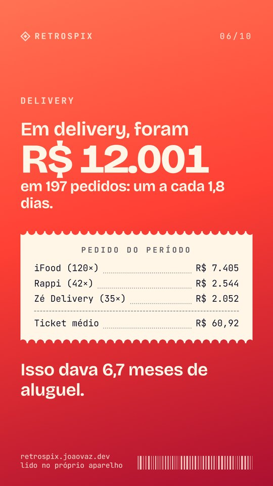
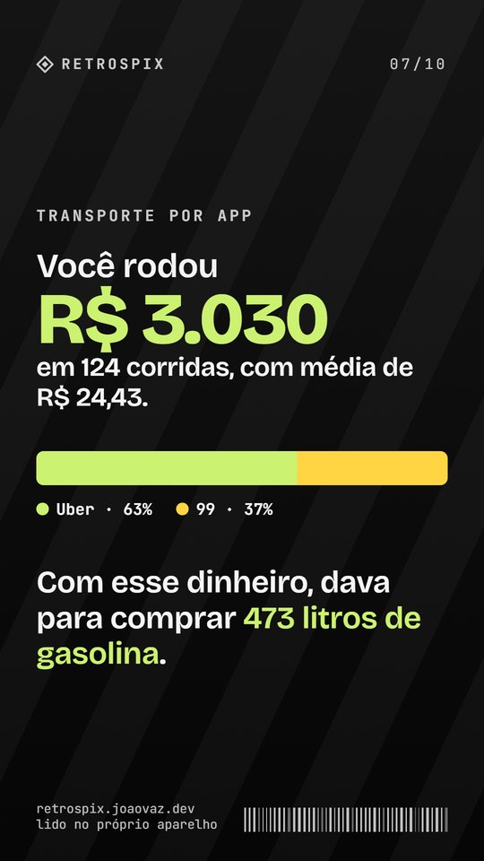
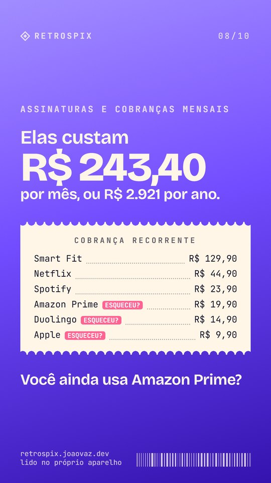
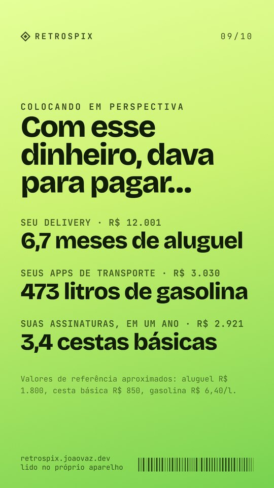
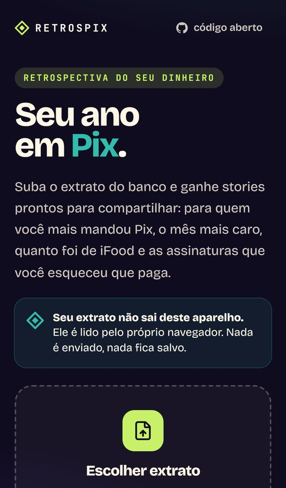
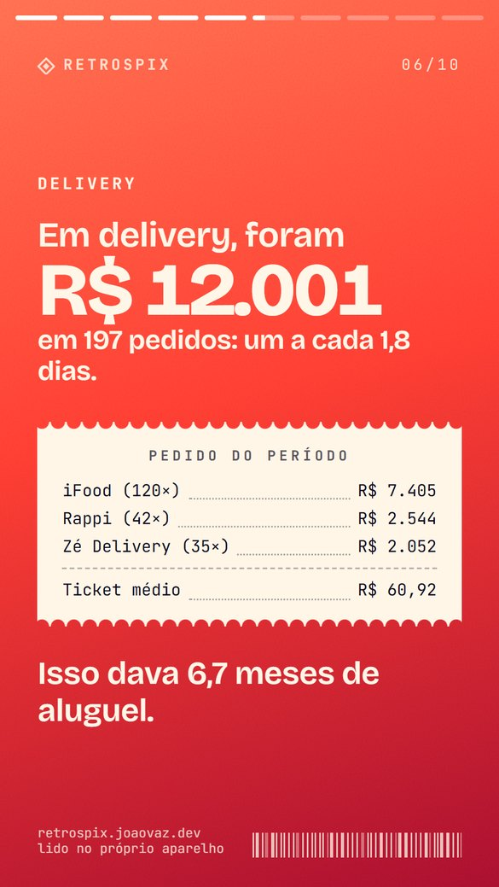

<div align="center">


# Retrospix

**A retrospectiva do seu dinheiro, em stories.**
Suba o extrato do banco e descubra para quem você mais mandou Pix, o mês mais caro, quanto foi de iFood e as assinaturas que você esqueceu que paga.

**[retrospix.joaovaz.dev](https://retrospix.joaovaz.dev)**

   

</div>

---

## O extrato não sai do seu aparelho

Esse é o ponto principal do projeto, então ele não é só uma promessa:

- **Não existe servidor que receba extrato.** O site é uma página estática. O arquivo é aberto pelo navegador (`File.arrayBuffer()`), lido e analisado em JavaScript no próprio aparelho.
- **O navegador é proibido de enviar dados.** A página vai para o ar com `Content-Security-Policy: connect-src 'self'`, e não há nenhuma rota no servidor para receber nada.
- **Sem analytics, sem cookies, sem `localStorage`.** O estado vive só na memória da aba: fechou, sumiu.
- **Dá para conferir.** A página mostra, ao vivo, quantos envios de dados aconteceram desde que você a abriu (spoiler: 0). E funciona no modo avião depois de carregar.
- **O teste de ponta a ponta verifica isso:** depois que o arquivo é escolhido, a única coisa que a página pode pedir são os próprios arquivos (`/_next/…`). Qualquer outra requisição faz o teste falhar.

## Os cards

| | | | |
|:-:|:-:|:-:|:-:|
|  |  |  |  |
| Quanto saiu da conta | Pix enviados e recebidos | Para quem você mais mandou | O mês e o dia mais caros |
|  |  |  |  |
| Gastos de madrugada | Delivery | Transporte por app | Assinaturas (e as esquecidas) |
|  |  | | |
| Comparações | Sua persona financeira | | |

> Todos os prints usam o **extrato de mentira** da demonstração. Nenhum dado real aparece neste repositório.

Cada card vira um PNG de **1080×1920** e vai direto para o Instagram, o WhatsApp ou outro app pela [Web Share API](https://developer.mozilla.org/docs/Web/API/Navigator/share). No computador, o arquivo é baixado. Uma chave troca os nomes das pessoas por iniciais antes de compartilhar.

Quando o extrato não traz horário (como o do Nubank), o card da madrugada dá lugar ao **fim de semana × dia útil**. Card sem dado não aparece: quem não pede delivery não vê um card de R$ 0.

## No celular

<div align="center">
  
</div>

## Bancos

| Banco | Formatos |
|---|---|
| Nubank | OFX e CSV da conta, CSV da fatura |
| Inter | OFX e CSV |
| Itaú | OFX |
| C6 Bank | OFX, CSV da conta e da fatura |
| Bradesco | OFX e CSV |
| Banco do Brasil | OFX e CSV (com o horário de cada Pix) |
| Santander | OFX |
| Mercado Pago | CSV e OFX |
| Outros | qualquer OFX, ou CSV com colunas de data, descrição e valor |

Dá para juntar vários arquivos (conta e cartão, ou bancos diferentes). Os duplicados saem e o pagamento da fatura não é contado duas vezes.

## Como funciona

```
arquivo ──▶ decodificar (UTF-8 ou Windows-1252)
        ──▶ leitor: OFX 1.x/2.x, CSV de cada banco, CSV genérico
        ──▶ Lancamento[] (data, hora, valor com sinal, descrição)
        ──▶ classificar: Pix, pessoa ou empresa, categoria pela marca
        ──▶ recorrência: mesma cobrança, valor parecido, todo mês
        ──▶ calcular: totais, rankings, mês e dia mais caros, persona
        ──▶ roteiro: quais cards fazem sentido para esse extrato
        ──▶ stories (CSS + cqw) ──▶ PNG 1080×1920 (modern-screenshot)
```

Tudo o que lê e calcula fica em funções puras em [`src/lib`](src/lib), com testes:

- [`parse/ofx.ts`](src/lib/parse/ofx.ts): OFX em SGML ou XML, conta ou cartão, banco pelo código FEBRABAN.
- [`parse/csv-bancos.ts`](src/lib/parse/csv-bancos.ts): um perfil por banco, que acha o cabeçalho mesmo quando vem um resumo antes da tabela, e um leitor genérico.
- [`analise/categorias.ts`](src/lib/analise/categorias.ts): tira o nome da pessoa do "Transferência enviada pelo Pix - FULANA - •••.123.456-•• - BANCO", separa pessoa de empresa (CPF mascarado × CNPJ) e reconhece as marcas (iFood, Uber, Netflix…).
- [`analise/recorrencia.ts`](src/lib/analise/recorrencia.ts): acha as assinaturas pela repetição e marca as pequenas e insistentes como "esqueceu?".
- [`analise/retrospectiva.ts`](src/lib/analise/retrospectiva.ts): junta tudo no objeto que os cards desenham.

Os cards são escritos em unidades de container (`cqw`): o mesmo componente aparece na tela do celular e é fotografado fora da tela em 1080×1920, sem diferença de layout.

## Rodando

```bash
npm install
npm run dev        # http://localhost:3000
npm test           # vitest: leitores, categorização, recorrência, cards
npm run build
```

Para testar sem extrato, use **Ver com um extrato de mentira** ou baixe o [extrato de exemplo](public/extrato-de-exemplo.ofx) (fictício) e suba na página.

Os testes usam apenas extratos inventados. O `.gitignore` bloqueia `*.ofx`, `*.csv` e `*.pdf` para que nenhum extrato real entre no repositório por engano.

## Stack

Next.js 16 (App Router, Cache Components, React Compiler) · React 19 · Tailwind CSS 4 · TypeScript · Zustand · modern-screenshot · Vitest · Playwright · Vercel (gru1)

---

<div align="center">
Feito por <a href="https://joaovaz.dev">João Vaz</a> · Não é um app de banco e não tem ligação com nenhum deles.
</div>
